# Расчёт стоимости поездки

Настольное приложение на Java 17 + JavaFX 21. Рассчитывает стоимость поездки по маршруту, виду транспорта, числу пассажиров и дополнительным услугам.
Приложение разрабатывается поэтапно: в каждой из 15 лабораторных работ добавляется модуль с одним или несколькими паттернами проектирования.

## Запуск

Нужен JDK 17 или новее. Если подходящего JDK нет, Gradle скачает его сам.

```bash
# Windows
gradlew.bat run

# Linux / macOS
./gradlew run
```

Сборка и тесты: `gradlew build`.

## Архитектура

Проект построен по схеме **MVVM (Model–View–ViewModel)**:

- **View** показывает интерфейс (FXML + code-behind) и привязывается к ViewModel через data binding. Бизнес-логики во View нет.
- **ViewModel** хранит состояние экрана в JavaFX-свойствах и обращается к Model. Классы View ей неизвестны.
- **Model** содержит предметную область и логику расчёта. От JavaFX не зависит.

```
src/main/java/ru/tripcost/
├── TripCostApp.java        точка входа JavaFX
├── external/geo/           имитация сторонней геобиблиотеки (код «чужой», не меняется)
├── model/                  Model
│   ├── domain/             сущности: поездка, маршрут, участок, пассажиры, деньги
│   ├── transport/          виды транспорта и их создание
│   ├── pricing/            алгоритмы расчёта: база, надбавки, скидки, налоги
│   ├── service/            внешние источники данных и единая точка расчёта
│   ├── journey/            составной маршрут из нескольких участков
│   ├── command/            команды редактирования маршрута
│   ├── approval/           согласование командировки
│   ├── request/            заявки на командировку
│   ├── booking/            бронирование: сага и сервисы-участники
│   ├── report/             отчёты о поездке
│   ├── data/               хранение данных: репозиторий шаблонов
│   ├── concurrent/         асинхронные расчёты: пул потоков и обещания
│   └── config/             настройки приложения
├── viewmodel/              ViewModel
└── view/                   View (code-behind)
src/main/resources/ru/tripcost/view/   FXML-разметка и стили
```

## Лабораторные работы

| ЛР | Паттерны | Модуль | Статус |
|----|----------|--------|--------|
| 1 | Одиночка, Строитель | `model.config`, `model.domain` | готово |
| 2 | Фабричный метод, Прототип | `model.transport`, `model.domain`, `model.pricing` | готово |
| 3 | Адаптер, Мост | `model.service`, `external.geo`, `model.report` | готово |
| 4 | Компоновщик, Декоратор | `model.domain` (статьи расходов), `model.transport` (декораторы) | готово |
| 5 | Фасад, Приспособленец | `model.service.TripPlanningFacade`, `model.domain` (города) | готово |
| 6 | Заместитель | `model.service.CachingDistanceProxy` | готово |
| 7 | Команда, Итератор | `model.command`, `model.journey` | готово |
| 8 | Цепочка обязанностей | `model.approval` | готово |
| 9 | Посредник, Снимок | `viewmodel` (посредник), `model.journey` (снимки) | готово |
| 10 | Наблюдатель, Состояние | `model.request` | готово |
| 11 | Стратегия, Шаблонный метод | `model.pricing` (стратегии), `model.transport` (время в пути) | готово |
| 12 | MVVM | все слои: `view`, `viewmodel`, `model` | готово |
| 13 | Паттерн микросервисов: Сага | `model.booking` | готово |
| 14 | Паттерн работы с данными: Репозиторий | `model.data` | готово |
| 15 | Идиоматический паттерн: Future / Promise | `model.concurrent` | готово |

Описание модулей и диаграммы классов добавляются в этот файл по мере выполнения работ.

## Как пользоваться

Вкладка **«Расчёт»**: выберите готовый шаблон и нажмите «Заполнить» либо введите параметры вручную и нажмите «Рассчитать». Справа появится стоимость по статьям, итог и доля на одного пассажира. Поля «Расход» и «Платные дороги» доступны только для тех видов транспорта, к которым они относятся.

Текущую форму можно сохранить как свой шаблон (поле «Название нового шаблона» → «Сохранить как шаблон»): шаблон записывается в файл `templates.properties` (по умолчанию в папке `.tripcost` домашнего каталога, путь — `storage.dir` в `app.properties`) и будет доступен после перезапуска. Кнопка «Удалить шаблон» удаляет выбранный шаблон пользователя; встроенные шаблоны не удаляются и не заменяются. Кнопка «Сравнить транспорт» считает ту же поездку на всех видах транспорта: стоимость и время в пути. Список «Критерий» задаёт, какой вариант лучший: дешевле всего, быстрее всего или «время - деньги» (к стоимости добавляется стоимость часов в пути, цена часа — `choice.hourValue` в `app.properties`). В результате расчёта строка «В пути» показывает время в одну сторону, подсказка — этапы поездки.

Кнопка «Определить» рядом с полем «Расстояние» подставляет расстояние между городами из геосервиса (для самолёта — по прямой, для остального транспорта — оценка по дорогам) и сообщает, получено ли оно из кэша. После расчёта в блоке результата можно выбрать вид отчёта (краткий или подробный) и формат (текст, HTML, Markdown), посмотреть отчёт или сохранить его в файл.

После расчёта в строке «Согласование» показано, кто согласует поездку как командировку, а под ней — причина решения и путь запроса по цепочке согласования (политика поездок → автосогласование → руководитель отдела → директор → финансовый комитет). Лимиты и правила политики задаются в `app.properties`.

Флажки «Доп. услуги» подключают высокий сезон, льготный тариф, багаж и страховку (недоступные для выбранного транспорта выключены). Стоимость показывается таблицей-деревом статей расходов: группа «Проезд» раскрывается на билеты или топливо и выбранные услуги.

Вкладка **«Маршрут»**: соберите поездку из нескольких участков (откуда, куда, транспорт → «Добавить участок»; следующий участок начинается там, где закончился предыдущий). Выбранный участок можно удалить, переместить выше или ниже, сменить на нём транспорт; «Добавить обратный путь» дописывает дорогу домой. Любое действие отменяется кнопкой «↶ Отменить» и повторяется кнопкой «↷ Повторить», справа — история команд. Внизу — итог по маршруту, доля на пассажира и километры по видам транспорта.

Вкладка **«Направления»**: выберите город, транспорт и число пассажиров — таблица покажет стоимость поездки во все остальные города справочника, от дешёвых к дорогим. В столбце «Согласование» — кто согласует каждую поездку. Внизу — статистика фабрики городов и кэша расстояний: повторный показ таблицы не обращается к геосервису и строится быстрее. Кнопка «Очистить кэш расстояний» сбрасывает кэш. Таблица считается в фоне параллельно в пуле потоков: окно не замирает, индикатор показывает ход расчёта, кнопка «Отменить» прерывает его.

Вкладки связаны между собой: кнопка «В маршрут» на вкладках «Расчёт» и «Направления» добавляет поездку участком в маршрут и открывает вкладку «Маршрут», а «Открыть в расчёте» на вкладке «Маршрут» рассчитывает выбранный участок на вкладке «Расчёт». В строке состояния внизу окна — последнее событие и итог маршрута. На вкладке «Маршрут» маршрут можно сохранить как вариант («Сохранить вариант») и позже вернуться к нему («Восстановить»; восстановление отменяется кнопкой «Отменить»).

Вкладка **«Заявки»**: кнопка «Оформить заявку» на вкладке «Расчёт» создаёт заявку на командировку (черновик). Заявку проводят по шагам: отправить на согласование → согласовать или отклонить → оплатить и забронировать → завершить (или отменить). Оплата — сага бронирования: билеты, гостиница, страховка, списание с бюджета отдела (`budget.department` в `app.properties`); флажки «нет билетов», «нет мест в гостинице», «страховая недоступна» имитируют сбои сервисов, журнал шагов саги показан под таблицей. Доступны только кнопки, разрешённые в текущем состоянии заявки. Внизу — журнал переходов и уведомления участникам.

Вкладка **«Тарифы»**: цены и тарифы из файла `src/main/resources/app.properties`.

---

## ЛР 1. Порождающие паттерны: Одиночка, Строитель

### Одиночка (Singleton) — `model.config.AppConfig`

Настройки и тарифы (цена топлива, расход по умолчанию, тарифы такси, автобуса, поезда и самолёта) хранятся в одном объекте `AppConfig`. Их читают расчёт стоимости, строитель поездки и обе вкладки интерфейса. Файл `app.properties` должен прочитаться один раз, а все части программы должны видеть одни и те же значения, поэтому класс сделан Одиночкой:

- конструктор `private`, создать объект снаружи нельзя;
- единственная точка доступа — статический метод `getInstance()`;
- экземпляр хранится во вложенном классе `Holder` (идиома *Initialization-on-demand holder*). JVM загружает `Holder` только при первом вызове `getInstance()`, поэтому объект создаётся лениво, а потокобезопасность гарантирует сама JVM, без `synchronized`.

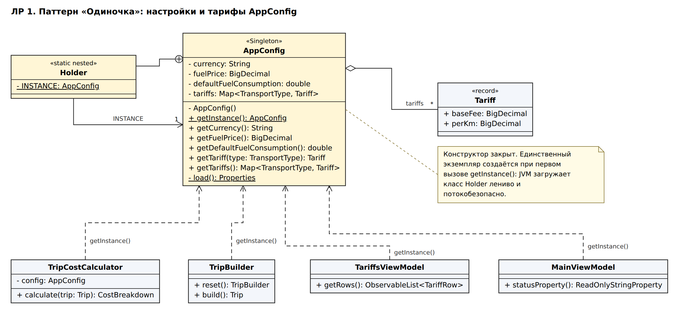

### Строитель (Builder) — `model.domain.TripBuilder`, `TripDirector`, `Trip`

У поездки десять параметров, часть из них необязательна, и некоторые зависят друг от друга: расход топлива нужен только автомобилю, платные дороги — только автомобилю и такси, а лимит пассажиров зависит от транспорта. Конструктор с десятью аргументами неудобен и не проверяет такие связи, поэтому поездка собирается Строителем:

| Роль в паттерне | Класс | Что делает |
|---|---|---|
| Product | `Trip` | Неизменяемая поездка. Конструктор доступен только внутри пакета |
| Builder | `TripBuilder` | Шаги `from()`, `to()`, `distance()`, `by()`, `passengers()`, `fuelConsumption()`, `roundTrip()`, `tolls()`, `accommodation()` возвращают сам строитель (fluent interface). `build()` проверяет данные, собирает все ошибки в `TripValidationException` и только потом создаёт `Trip` |
| Director | `TripDirector` | Знает, какие шаги вызвать для типовой поездки (`TripPreset`: выходные на машине, командировка на поезде, отпуск на самолёте, такси до аэропорта) |
| Client | `TripCalculatorViewModel` | По кнопке «Рассчитать» собирает поездку из полей формы через `TripBuilder`. Встроенные шаблоны собирает `TripDirector` (с ЛР 2 — через реестр шаблонов) |

```java
Trip trip = Trip.builder()
        .from("Ставрополь").to("Кисловодск").distance(210)
        .by(TransportType.CAR).passengers(3).fuelConsumption(8.0)
        .roundTrip(true)
        .accommodation(1, new BigDecimal("4500"))
        .build();
```

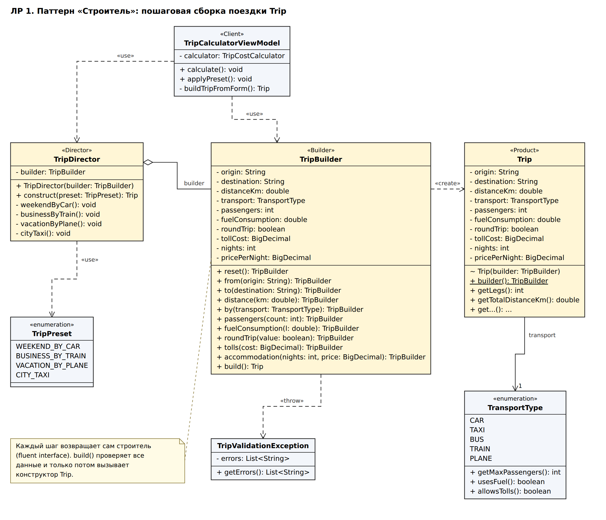

### Проверка

Модульные тесты (`gradlew test`): `AppConfigTest` проверяет, что экземпляр один (в том числе при обращении из 8 потоков) и что конструктор закрыт; `TripBuilderTest` — сборку, значения по умолчанию и проверки данных; `TripDirectorTest` — шаблоны; `TripCostCalculatorTest` — формулы расчёта.

Исходники диаграмм в формате PlantUML: `images/lab01/*.puml`.

---

## ЛР 2. Порождающие паттерны: Фабричный метод, Прототип

По заданию нужно два паттерна из трёх (Абстрактная фабрика, Фабричный метод, Прототип). Реализованы **Фабричный метод** и **Прототип**.

### Фабричный метод (Factory Method) — `model.transport`

В ЛР 1 стоимость проезда считалась в `TripCostCalculator` цепочкой `if` по виду транспорта. Теперь каждый вид транспорта — отдельный класс-продукт с общим интерфейсом `Transport`, а создают их фабрики:

| Роль | Классы | Что делает |
|---|---|---|
| Product | `Transport` | Интерфейс транспорта: `cost(trip)`, `describeBaseFee()`, `describePerKm()` |
| ConcreteProduct | `PrivateCar`, `Taxi`, `Bus`, `Train`, `Plane` | Считают стоимость по своим правилам: автомобиль — по топливу, такси — за машину, автобус, поезд и самолёт — билет на каждого пассажира (общая часть вынесена в `TicketTransport`) |
| Creator | `TransportFactory` | Объявляет фабричный метод `createTransport()` и операцию `transportCost(trip)`, которая работает с продуктом только через интерфейс |
| ConcreteCreator | `CarFactory`, `TaxiFactory`, `BusFactory`, `TrainFactory`, `PlaneFactory` | Переопределяют `createTransport()` и возвращают свой транспорт |

`TransportFactories.forType(type)` возвращает фабрику для вида транспорта. Её используют `TripCostCalculator` (расчёт) и `TariffsViewModel` (вкладка «Тарифы»). Чтобы добавить новый вид транспорта, достаточно написать класс транспорта и его фабрику, код расчёта менять не нужно.

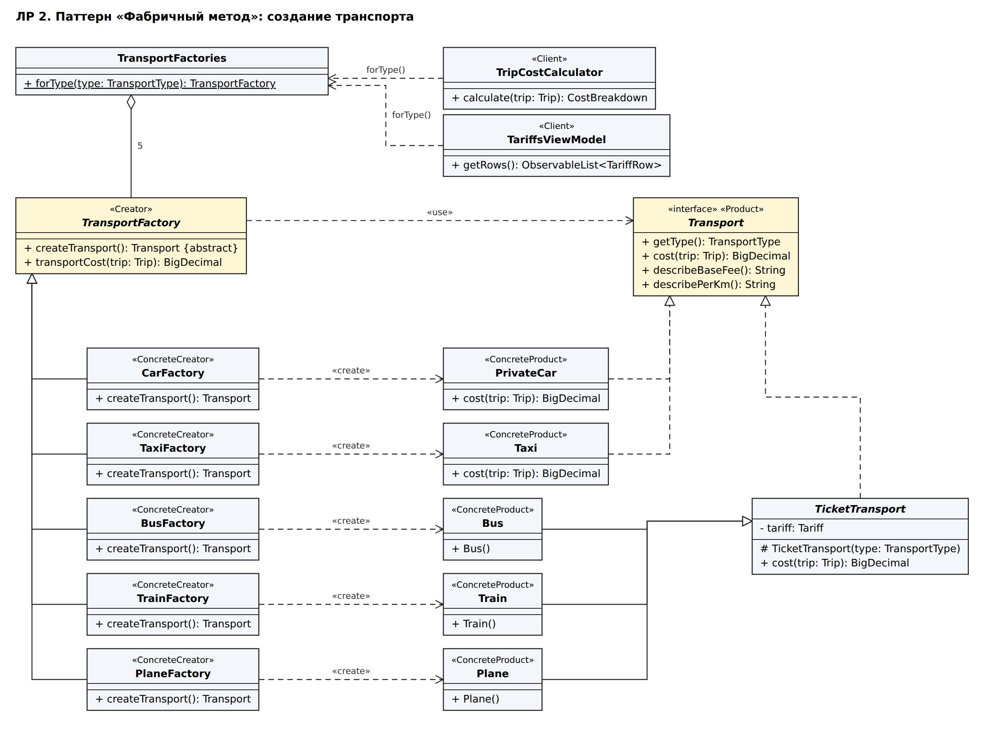

### Прототип (Prototype) — `model.domain`, `model.pricing`

Объект `Trip` неизменяемый, поэтому копировать его незачем. Копируется настроенная заготовка поездки — `TripBuilder`. Он реализует интерфейс `Prototype<TripBuilder>`: метод `copy()` через закрытый конструктор копирования возвращает новый строитель со всеми заданными частями. Все поля строителя — примитивы, строки, перечисления и `BigDecimal`, то есть неизменяемые значения, поэтому копия полностью независима от оригинала.

Прототип используется в двух местах:

- **`TripTemplateRegistry`** — реестр прототипов. Встроенные шаблоны собирает `TripDirector` из ЛР 1, пользовательские добавляются кнопкой «Сохранить как шаблон». `register()` сохраняет копию, `create()` выдаёт копию, поэтому изменения формы не портят шаблон.
- **`TransportComparison`** — для каждого вида транспорта копирует заготовку, меняет в копии только транспорт и считает стоимость. Исходная заготовка остаётся без изменений.

```java
TripBuilder variant = prototype.copy().by(TransportType.TRAIN);   // оригинал не меняется
Trip trip = variant.build();
```

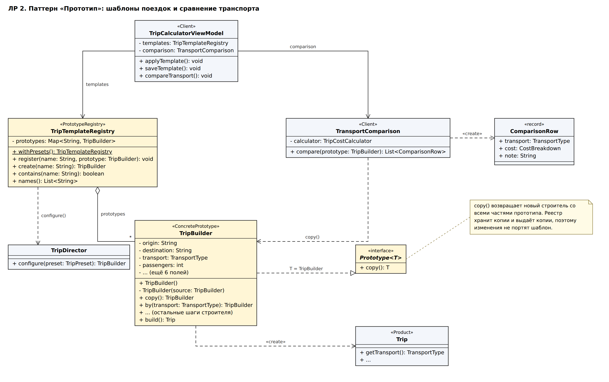

### Проверка

`TransportFactoryTest` проверяет, что каждая фабрика создаёт свой транспорт и новый объект при каждом вызове. `TripBuilderPrototypeTest` проверяет, что копия собирает такую же поездку и не зависит от оригинала. `TripTemplateRegistryTest` проверяет, что реестр выдаёт копии, а изменения копии не меняют шаблон. `TransportComparisonTest` проверяет, что сравнение не меняет прототип и что такси недоступно для пяти пассажиров. Тесты ЛР 1 на формулы расчёта проходят без изменений: переход на фабрики результат не поменял.

Исходники диаграмм: `images/lab02/*.puml`.

---

## ЛР 3. Структурные паттерны: Адаптер, Мост

### Адаптер (Adapter) — `model.service`, `external.geo`

Расстояние теперь можно не вводить вручную, а определить кнопкой «Определить». Считает его сторонняя геобиблиотека `WorldGeoApi` (в проекте её имитирует пакет `ru.tripcost.external.geo`). Её интерфейс несовместим с приложением: города ищутся по англоязычным названиям, неизвестный город возвращает `null`, а расстояние считается по координатам в милях.

| Роль | Класс | Что делает |
|---|---|---|
| Target | `DistanceService` | Интерфейс, который нужен приложению: русские названия на входе, километры на выходе |
| Adapter | `GeoApiDistanceAdapter` | Реализует `DistanceService`: переводит название в англоязычное, превращает `null` в исключение, мили — в километры, оценивает путь по дорогам (× 1,3) |
| Adaptee | `WorldGeoApi`, `GeoPoint` | Сторонняя библиотека с несовместимым интерфейсом |
| Client | `TripCalculatorViewModel` | Знает только `DistanceService` |

Для самолёта берётся расстояние по прямой (`RouteDistance.forTransport()`). Чтобы заменить библиотеку, достаточно написать новый адаптер.

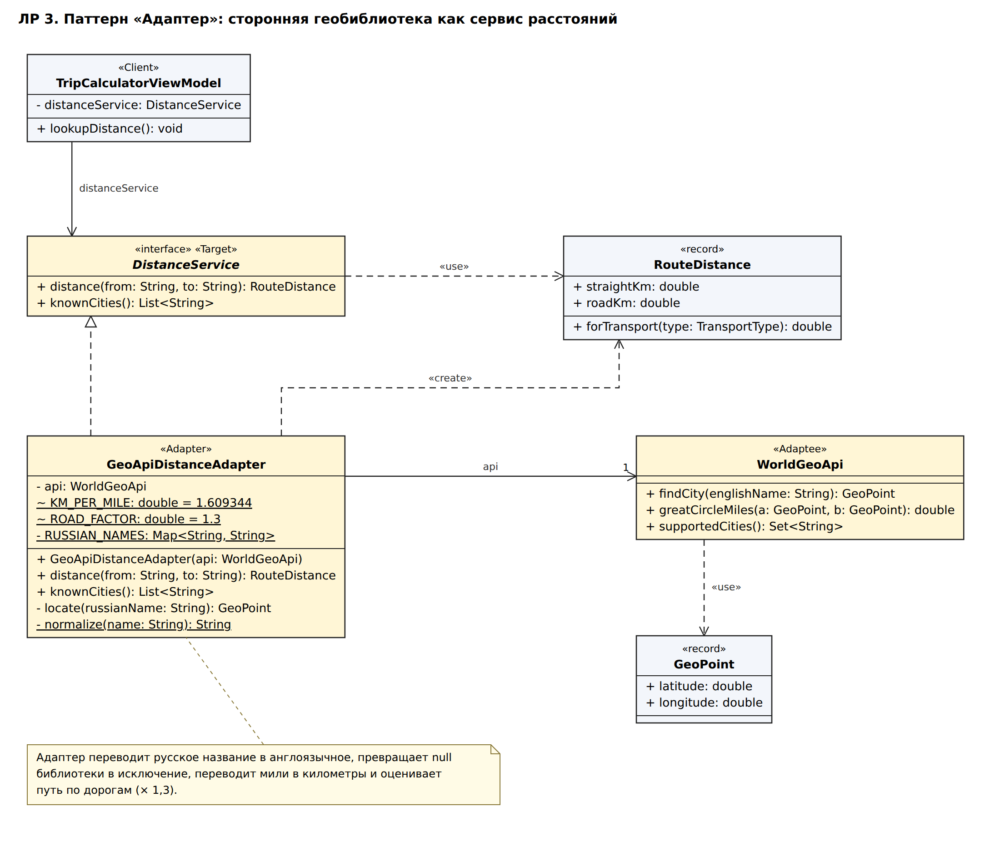

### Мост (Bridge) — `model.report`

Отчёт о поездке бывает двух видов (краткий, подробный) и сохраняется в трёх форматах (текст, HTML, Markdown). Вместо шести классов на каждое сочетание — две независимые иерархии:

| Роль | Класс | Что делает |
|---|---|---|
| Abstraction | `TripReport` | Хранит ссылку на формат (`format` — это и есть мост), метод `render()` собирает документ |
| RefinedAbstraction | `ShortTripReport`, `DetailedTripReport` | Решают, **что** попадёт в отчёт |
| Implementor | `ReportFormat` | Интерфейс оформления: заголовок, раздел со строками, примечание, документ |
| ConcreteImplementor | `PlainTextFormat`, `HtmlFormat`, `MarkdownFormat` | Решают, **как** это оформить |
| Client | `TripCalculatorViewModel` | Соединяет выбранный вид отчёта с выбранным форматом |

```java
ReportFormat format = ReportFormatType.HTML.create();
TripReport report = ReportType.DETAILED.create(format, trip, cost);
String html = report.render();
```

Новый формат (например, CSV) — один новый класс, отчёты менять не нужно.

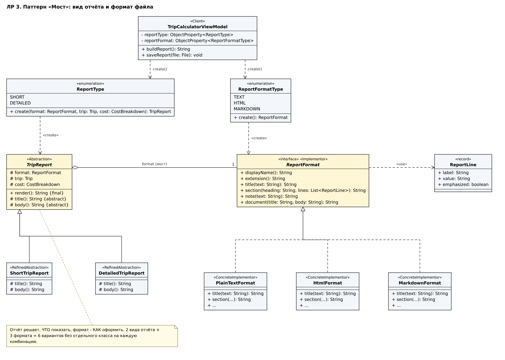

### Проверка

`GeoApiDistanceAdapterTest` проверяет перевод миль в километры, оценку по дорогам, разные варианты написания («г. санкт-петербург», «ё»/«е») и ошибку для неизвестного города. `TripReportTest` проверяет, что каждый вид отчёта работает с каждым форматом, что содержание задаёт отчёт, а разметку — формат, и что HTML экранирует пользовательский текст.

Исходники диаграмм: `images/lab03/*.puml`.

---

## ЛР 4. Структурные паттерны: Компоновщик, Декоратор

### Декоратор (Decorator) — `model.transport`

К проезду можно подключить услуги в любом сочетании (значения — в `app.properties`):

| Услуга | Декоратор | Надбавка | Для какого транспорта |
|---|---|---|---|
| Высокий сезон | `PeakSeasonDecorator` | +20 % к стоимости проезда | такси, автобус, поезд, самолёт |
| Льготный тариф | `DiscountDecorator` | −25 % | автобус, поезд, самолёт |
| Багаж | `BaggageDecorator` | 700 ₽ за пассажира за поездку в одну сторону | автобус, поезд, самолёт |
| Страховка | `InsuranceDecorator` | 3 % от проезда со всеми услугами | любой |

Каждый декоратор реализует тот же интерфейс `Transport`, хранит ссылку `inner` на обёрнутый транспорт и добавляет к его стоимости свою часть. Абстрактный `TransportDecorator` передаёт обёрнутому объекту все вызовы, подклассы задают только `extra()` и `label()`. Обёртку строит `TransportDecorators.decorate()`, вызывает его фабрика в `TransportFactory.createFor(trip)`:

```java
Transport plane = new InsuranceDecorator(new BaggageDecorator(new Plane()));
plane.cost(trip);   // билеты + багаж + 3 % страховки
```

Услуги хранятся в `Trip.getOptions()` (`TripOption`), строитель проверяет, что услуга доступна для транспорта. При копировании строителя (Прототип) набор услуг `EnumSet` копируется глубоко.

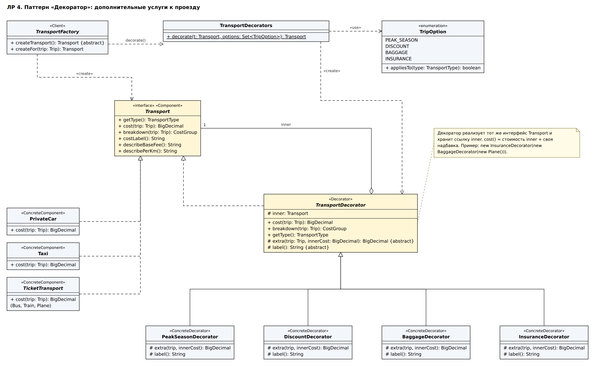

### Компоновщик (Composite) — `model.domain`

Расходы образуют дерево: «Все расходы» → «Проезд» (билеты, багаж, страховка…) + «Платные дороги» + «Проживание».

| Роль | Класс | Что делает |
|---|---|---|
| Component | `CostItem` | Общий интерфейс: `name()`, `amount()`, `children()` |
| Leaf | `CostLeaf` | Отдельная статья |
| Composite | `CostGroup` | Группа статей; `amount()` рекурсивно суммирует вложенные элементы |
| Client | `TransportDecorator`, `TripCostCalculator`, `DetailedTripReport`, `TripCalculatorViewModel` | Строят и обходят дерево, не различая статьи и группы |

Декоратор в `breakdown()` берёт группу статей обёрнутого транспорта и добавляет свою статью, калькулятор собирает корень «Все расходы», итог — `amount()` корня. Во View дерево показывается `TreeTableView`, в подробном отчёте — строками с вложенными пунктами.

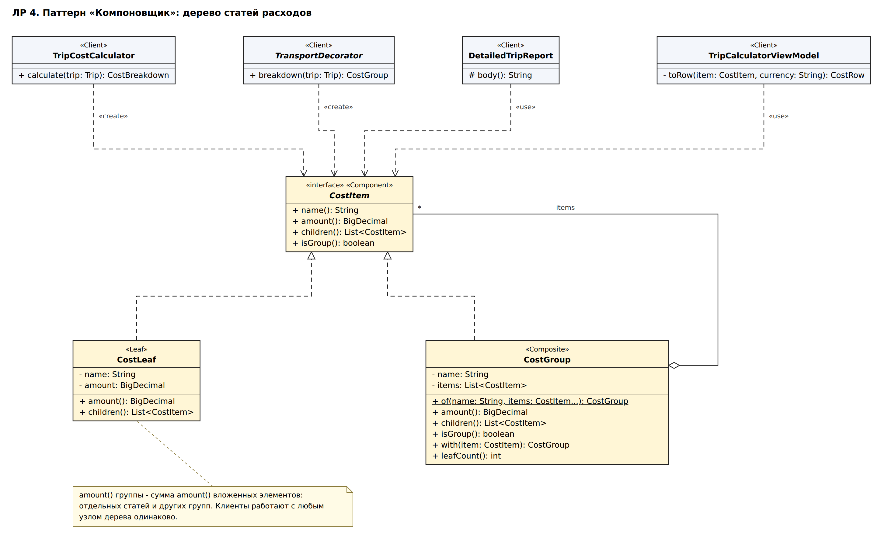

### Проверка

`TransportDecoratorTest` — стоимость с каждой услугой и их сочетанием, интерфейс обёрнутого объекта сохраняется, статьи расходов перечислены в порядке обёртки. `CostGroupTest` — рекурсивная сумма, одинаковая работа со статьёй и группой, неизменяемость. `TripOptionTest` — запрет недоступных услуг и глубокое копирование набора услуг. `TripCostCalculatorTest.costTreeMatchesTotal` — сумма дерева равна итогу.

Исходники диаграмм: `images/lab04/*.puml`.

---

## ЛР 5. Структурные паттерны: Фасад, Приспособленец

### Фасад (Facade) — `model.service.TripPlanningFacade`

К этому моменту модель состоит из нескольких подсистем: реестр шаблонов (Прототип), сервис расстояний с адаптером геобиблиотеки, калькулятор с фабриками и декораторами транспорта, сравнение транспорта, отчёты (Мост), фабрика городов. Раньше `TripCalculatorViewModel` создавала и вызывала их все сама. Теперь у модели одна точка входа — `TripPlanningFacade`:

| Метод фасада | Что делает за кулисами |
|---|---|
| `template(name)`, `saveTemplate(...)` | реестр прототипов `TripTemplateRegistry` |
| `distance(from, to)` | `DistanceService` → `GeoApiDistanceAdapter` → `WorldGeoApi` |
| `calculate(trip)` | `TripCostCalculator` → фабрики транспорта → декораторы → дерево статей |
| `compare(prototype)` | `TransportComparison` |
| `report(type, format, trip, cost)` | `ReportType` + `ReportFormatType` (Мост) |
| `quickQuote(from, to, transport, passengers, roundTrip)` | расстояние → строитель поездки → расчёт — одним вызовом |
| `directionsFrom(origin, ...)` | `quickQuote` для всех городов + фабрика городов |

Обе модели представления (`TripCalculatorViewModel`, `DirectionsViewModel`) работают только с фасадом.

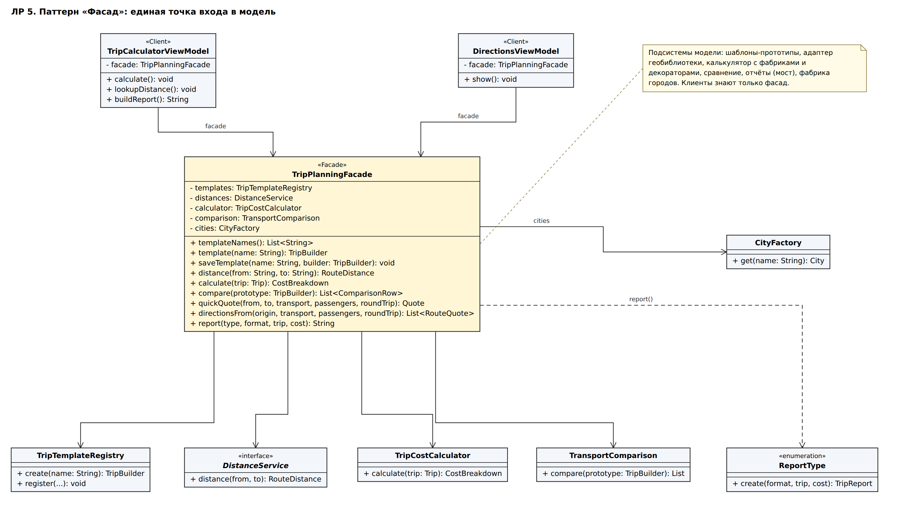

### Приспособленец (Flyweight) — `model.domain`

Вкладка «Направления» строит по строке на каждый город назначения, а полный перебор «из каждого в каждый» — 600 маршрутов. Каждый маршрут (`RouteQuote`) ссылается на два города. Чтобы не создавать 1200 одинаковых объектов, города — приспособленцы:

| Роль | Класс | Что делает |
|---|---|---|
| Flyweight | `City` | Неизменяемое внутреннее состояние: название, регион, федеральный округ. Метод `routeTo(other, km)` получает внешнее состояние параметрами |
| FlyweightFactory | `CityFactory` | Пул городов: `get(name)` возвращает уже созданный объект или создаёт новый при первом запросе |
| Context | `RouteQuote` | Внешнее состояние (транспорт, расстояние, стоимость) + ссылки на общие `City` |
| Client | `TripPlanningFacade` | Берёт города у фабрики и собирает маршруты |

600 маршрутов между 25 городами используют 25 объектов `City`. Статистика фабрики (запросы и созданные объекты) выводится под таблицей направлений.

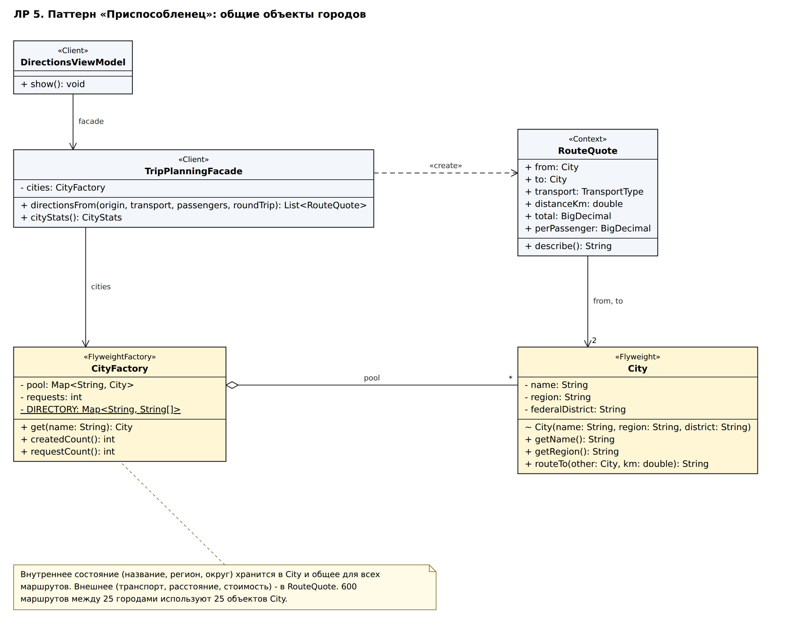

### Проверка

`TripPlanningFacadeTest` — быстрая оценка даёт тот же результат, что и прямой вызов подсистем, самолёт считается по прямой, шаблоны и отчёты доступны через фасад, направления отсортированы по цене. `CityFactoryTest` — один объект на город при любом написании, данные региона из справочника, внешнее состояние передаётся параметром, 600 маршрутов используют 25 объектов `City`.

Исходники диаграмм: `images/lab05/*.puml`.

---

## ЛР 6. Структурные паттерны: Заместитель

### Заместитель (Proxy) — `model.service.CachingDistanceProxy`

Геосервис удалённый: каждый запрос расстояния занимает время (задержка имитируется в `GeoApiDistanceAdapter`, параметр `geo.latencyMs` в `app.properties`, по умолчанию 40 мс). Вкладка «Направления» делает 24 запроса на каждый показ, хотя расстояния между городами не меняются. Фасад обращается к геосервису не напрямую, а через заместителя с тем же интерфейсом `DistanceService`:

| Роль | Класс | Что делает |
|---|---|---|
| Subject | `DistanceService` | Общий интерфейс реального сервиса и заместителя |
| RealSubject | `GeoApiDistanceAdapter` | Реальный запрос к геосервису (через адаптер `WorldGeoApi`) |
| Proxy | `CachingDistanceProxy` | Контролирует доступ к реальному сервису: создаёт его лениво, кэширует ответы, считает обращения |
| Client | `TripPlanningFacade` | Работает с заместителем как с обычным `DistanceService` |

Что делает заместитель:

- **виртуальный заместитель** — реальный сервис создаётся фабрикой `Supplier<DistanceService>` только при первом обращении;
- **кэширующий заместитель** — расстояние между парой городов запрашивается у геосервиса один раз; ключ не зависит от направления и написания («Казань → Ставрополь» берётся из кэша после «Ставрополь → Казань»); ошибки не кэшируются;
- **учёт обращений** — `stats()` возвращает число запросов, попаданий в кэш, обращений к геосервису и размер кэша; `clearCache()` сбрасывает кэш.

На вкладке «Направления» первый показ таблицы делает 24 обращения к геосервису (~1 с), повторный — ни одного, время показа выводится под таблицей.

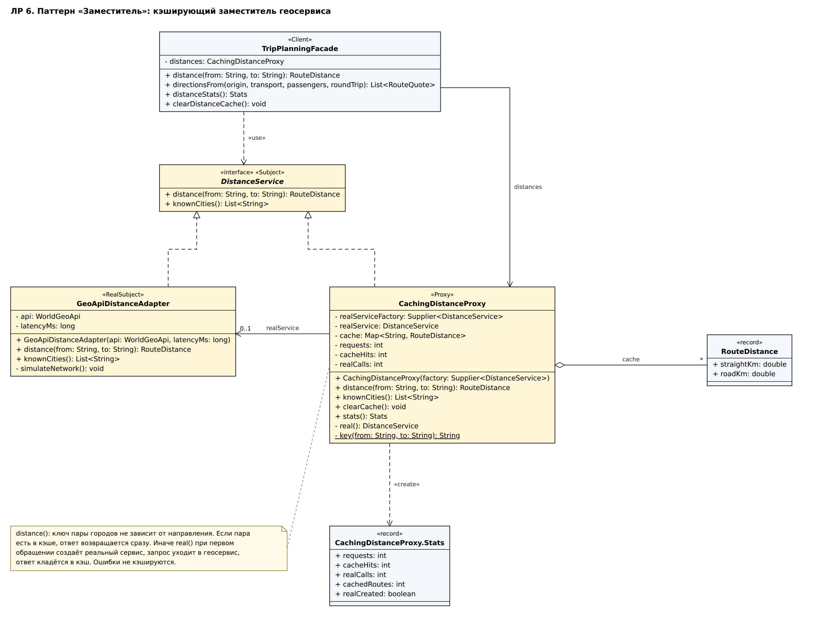

### Проверка

`CachingDistanceProxyTest` — заместитель возвращает те же расстояния, что и реальный сервис; реальный сервис создаётся при первом запросе; повторный и обратный запросы берутся из кэша; ошибки не кэшируются; после `clearCache()` запрос снова идёт в геосервис; два показа направлений обращаются к геосервису 24 раза, а не 48.

Исходник диаграммы: `images/lab06/lab06_proxy.puml`.

---

## ЛР 7. Поведенческие паттерны: Команда, Итератор

Новая вкладка «Маршрут» — поездка из нескольких участков (например, Ставрополь → Москва поездом, Москва → Казань самолётом). Маршрут (`model.journey.Journey`) редактируется командами, а обходится итераторами.

### Команда (Command) — `model.command`

| Роль | Класс | Что делает |
|---|---|---|
| Command | `Command` | `execute()`, `undo()`, `description()` |
| ConcreteCommand | `AddLegCommand`, `RemoveLegCommand`, `MoveLegCommand`, `ChangeTransportCommand`, `AddReturnTripCommand` | Действие над маршрутом; запоминают всё, что нужно для отмены (индекс, удалённый участок, прежний транспорт, число добавленных участков) |
| Invoker | `CommandHistory` | Выполняет команды; стек отмены и стек повтора; новая команда очищает стек повтора |
| Receiver | `Journey` | Маршрут: `add`, `insert`, `remove`, `set`, `swap` |
| Client | `JourneyViewModel` | Создаёт команду на каждое действие пользователя и передаёт её в `CommandHistory` |

Кнопки «Отменить» и «Повторить» доступны, только когда есть что отменять или повторять; подсказка на кнопке показывает описание команды. Команда, завершившаяся ошибкой, в историю не попадает.

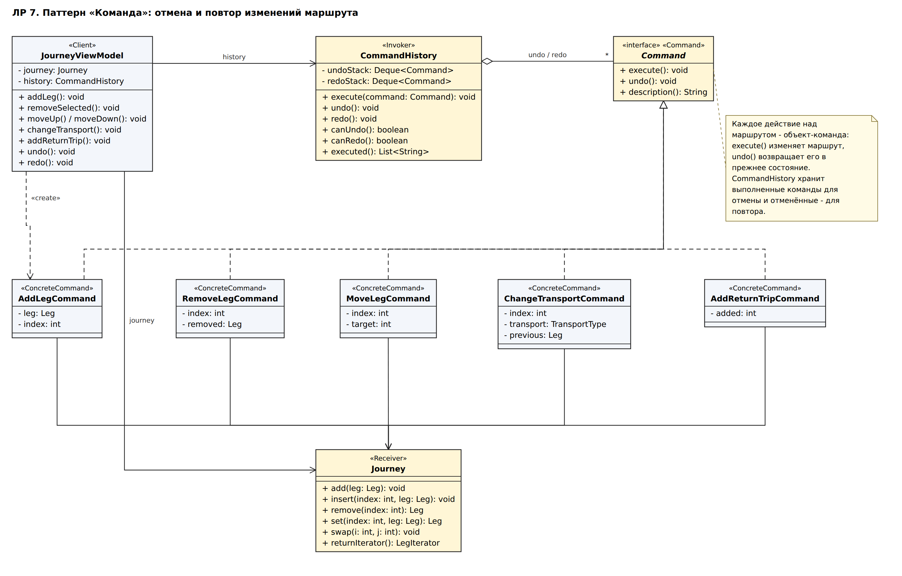

### Итератор (Iterator) — `model.journey`

`Journey` хранит участки во внутреннем массиве `Leg[]`, который наружу не выдаётся. Обход — только через итераторы:

| Роль | Класс | Что делает |
|---|---|---|
| Aggregate | `Journey` (`Iterable<Leg>`) | Создаёт итераторы: `iterator()`, `returnIterator()`, `iterator(transport)` |
| Iterator | `LegIterator` (`Iterator<Leg>`) | `hasNext()`, `next()` и `number()` — номер участка в маршруте |
| ConcreteIterator | `Journey.ForwardIterator` | Участки по порядку поездки |
| ConcreteIterator | `Journey.ReturnIterator` | Путь домой: с последнего участка, каждый развёрнут (`Leg.reversed()`) |
| ConcreteIterator | `TransportFilterIterator` | Поверх другого итератора пропускает участки на другом транспорте |
| Client | `TripPlanningFacade.quoteJourney()`, `AddReturnTripCommand` | Считают стоимость, километры по видам транспорта, строят обратный путь |

Итераторы «быстро отказывают»: если маршрут изменился во время обхода, `next()` выбрасывает `ConcurrentModificationException`. Поэтому `AddReturnTripCommand` сначала собирает обратные участки, а потом добавляет их.

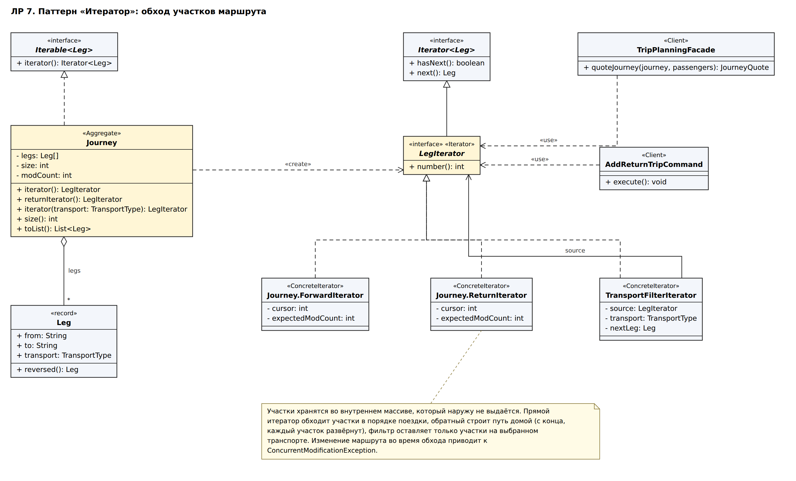

### Проверка

`CommandHistoryTest` — каждая команда отменяется и возвращает маршрут в прежнее состояние, повтор, очистка стека повтора, неудачная команда не попадает в историю. `JourneyIteratorTest` — порядок и номера прямого обхода, обратный обход с развёрнутыми участками, фильтр по транспорту с исходными номерами, исключение при изменении маршрута во время обхода, рост внутреннего массива. `TripPlanningFacadeTest` — стоимость маршрута равна сумме участков, километры по транспорту, разрыв маршрута и ошибочный участок.

Исходники диаграмм: `images/lab07/*.puml`.

---

## ЛР 8. Поведенческие паттерны: Цепочка обязанностей

### Цепочка обязанностей (Chain of Responsibility) — `model.approval`

Поездку можно оформить как командировку: её нужно согласовать. Кто согласует — зависит от стоимости, а поездки, нарушающие политику, отклоняются сразу. Запрос `ApprovalRequest` (поездка + стоимость) отправляется в первое звено цепочки и идёт по ней, пока какое-то звено не примет решение:

```
Политика поездок → Автосогласование (до 15 000 ₽) → Руководитель отдела (до 60 000 ₽)
                 → Директор (до 250 000 ₽) → Финансовый комитет
```

| Роль | Класс | Что делает |
|---|---|---|
| Handler | `ApprovalHandler` | Ссылка на следующее звено `next`, `linkWith()` для сборки, `passToNext()`, `approve()`, `reject()` |
| ConcreteHandler | `TravelPolicyHandler` | Проверяет политику: такси — не дальше 150 км, самолёт — от 500 км, проживание — не дороже 7 000 ₽ за ночь. Нарушение — отказ, иначе дальше |
| ConcreteHandler | `LimitApprovalHandler` | Согласует, если стоимость не выше лимита, иначе передаёт дальше (автосогласование, руководитель, директор) |
| ConcreteHandler | `FinanceCommitteeHandler` | Последнее звено: рассматривает поездки любой стоимости |
| Client | `TripPlanningFacade` | `approve(trip, cost)` — отправляет запрос в первое звено; сборка цепочки — `ApprovalChain.standard()` |

Результат — `ApprovalDecision`: согласовано или нет, кто принял решение, причина и путь запроса (что сделало каждое звено). Лимиты и правила — в `app.properties` (`approval.*`, `policy.*`). Для шаблонов: «Такси до аэропорта» и «Выходные в Кисловодске на машине» — автосогласование, «Командировка в Москву на поезде» — руководитель отдела, «Отпуск в Санкт-Петербурге на самолёте» — директор.

Где видно в программе: строка «Согласование» и путь по цепочке на вкладке «Расчёт», столбец «Согласование» на вкладке «Направления».

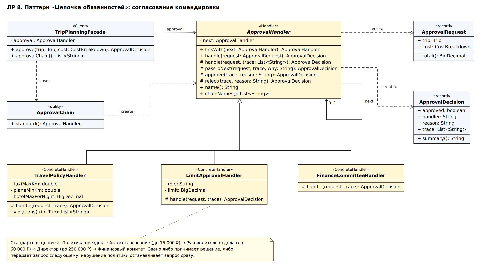

### Проверка

`ApprovalChainTest` — порядок звеньев; дешёвая поездка согласуется автоматически, командировка — руководителем, отпуск — директором, очень дорогая поездка доходит до финансового комитета; нарушение политики останавливает запрос на первом звене; цепочка без последнего звена отказывает, если никто не может принять решение; звенья можно переставлять.

Исходник диаграммы: `images/lab08/lab08_chain.puml`.

---

## ЛР 9. Поведенческие паттерны: Посредник, Снимок

### Посредник (Mediator) — `viewmodel`

Модели представления вкладок ничего не знают друг о друге. О событиях они сообщают посреднику, а он решает, кто должен отреагировать:

| Событие (`PlannerEvent`) | Отправитель | Что делает посредник |
|---|---|---|
| `AddLegRequested` | `TripCalculatorViewModel` («В маршрут»), `DirectionsViewModel` («В маршрут») | Добавляет участок в `JourneyViewModel` (командой, отменяемо), открывает вкладку «Маршрут», пишет в строку состояния |
| `OpenInCalculatorRequested` | `JourneyViewModel` («Открыть в расчёте») | Заполняет форму `TripCalculatorViewModel` и считает поездку, открывает вкладку «Расчёт» |
| `JourneyChanged` | `JourneyViewModel` (после каждого изменения) | Показывает число участков и итог маршрута в строке состояния |

| Роль | Класс |
|---|---|
| Mediator | `PlannerMediator` |
| ConcreteMediator | `TripPlannerMediator` — знает все вкладки и `MainViewModel` (строка состояния, выбранная вкладка) |
| Colleague | `PlannerColleague` — `setMediator()` |
| ConcreteColleague | `TripCalculatorViewModel`, `JourneyViewModel`, `DirectionsViewModel` |

Посредника создаёт `MainViewModel.connect(...)`; модели вкладок главное окно получает из контроллеров вложенных FXML (`fx:include fx:id="calculator"` → поле `calculatorController`).

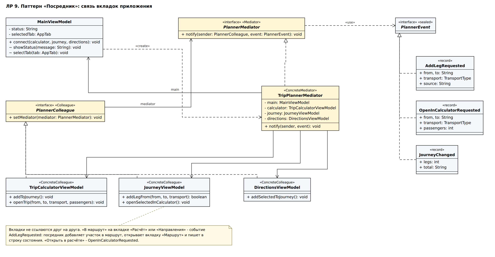

### Снимок (Memento) — `model.journey`

| Роль | Класс | Что делает |
|---|---|---|
| Originator | `Journey` | `save(name)` — снимок, `restore(memento)` — возврат к нему |
| Memento | `Journey.Memento` | Копия участков в закрытом поле; снаружи видны только название, число участков и время |
| Caretaker | `JourneyVersions` | Хранит варианты по названиям, не заглядывая внутрь снимков |

Восстановление варианта выполняется командой `RestoreVersionCommand` (паттерн «Команда»): перед восстановлением она делает снимок текущего маршрута, поэтому «Отменить» возвращает маршрут как был.

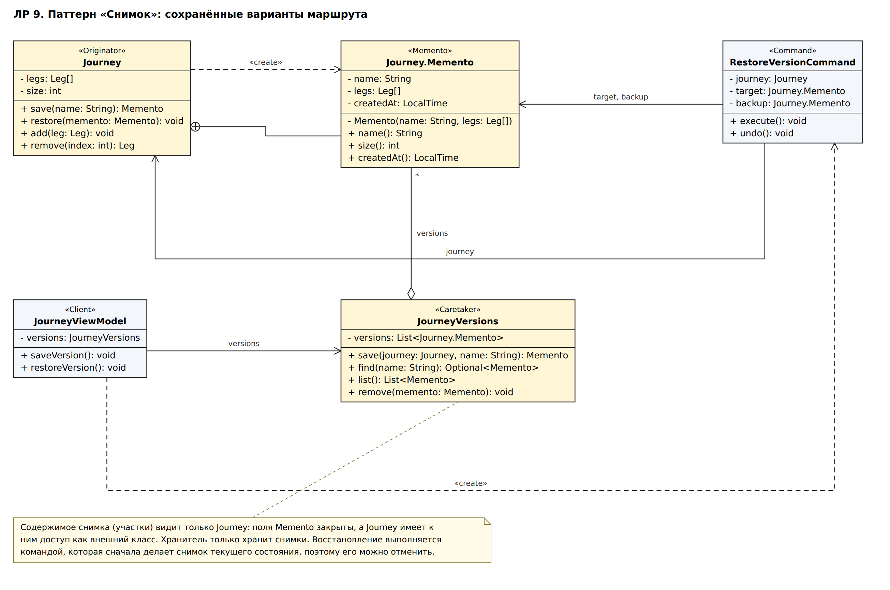

### Проверка

`JourneyMementoTest` — восстановление состояния, независимость снимка от последующих изменений, хранитель с заменой по названию, отмена восстановления. `TripPlannerMediatorTest` — «В маршрут» из расчёта и из направлений, «Открыть в расчёте», строка состояния, сохранение и восстановление варианта через модель представления.

Исходники диаграмм: `images/lab09/*.puml`.

---

## ЛР 10. Поведенческие паттерны: Наблюдатель, Состояние

Новая вкладка «Заявки»: заявка на командировку (`model.request.TripRequest`) по рассчитанной поездке. Заявка создаётся кнопкой «Оформить заявку» на вкладке «Расчёт» (через посредника).

### Состояние (State) — `model.request`

```
Черновик ──отправить──▶ (цепочка согласования) ──▶ На согласовании ──согласовать──▶ Согласована ──оплатить──▶ Оплачена ──завершить──▶ Завершена
    ▲                        │ автосогласование ──▶ Согласована          └─отклонить─▶ Отклонена
    └───── вернуть в черновик ┴ нарушение политики ─▶ Отклонена ◀─────────┘
Отменить: из «Черновик», «На согласовании», «Согласована» ──▶ Отменена
```

| Роль | Класс | Что делает |
|---|---|---|
| Context | `TripRequest` | Хранит текущее состояние и делегирует ему `submit()`, `approve()`, `reject()`, `pay()`, `complete()`, `cancel()`, `revise()` |
| State | `RequestState` | Действия + `allowedActions()` — какие кнопки доступны |
| — | `AbstractRequestState` | По умолчанию любое действие запрещено (исключение с понятным сообщением) |
| ConcreteState | `RequestStates.Draft`, `Pending`, `Approved`, `Rejected`, `Paid`, `Completed`, `Cancelled` | Разрешают свои действия и переводят заявку в следующее состояние |

`Draft.submit()` прогоняет заявку по цепочке согласования (ЛР 8): автосогласование — сразу «Согласована», нарушение политики — «Отклонена», иначе — «На согласовании» у руководителя, директора или финансового комитета. Состояния без данных, поэтому каждое — единственный общий объект.

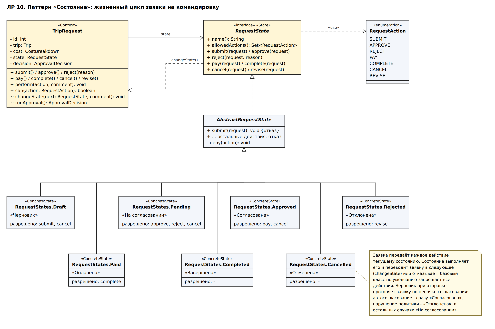

### Наблюдатель (Observer) — `model.request`

| Роль | Класс | Реакция на переход |
|---|---|---|
| Subject | `TripRequest` | `addListener()`, `removeListener()`, оповещает всех в `changeState()` |
| Observer | `RequestListener` | `onStateChanged(StateChange)` |
| ConcreteObserver | `RequestJournal` | Журнал всех переходов (время, заявка, из какого состояния в какое, комментарий) |
| ConcreteObserver | `NotificationCenter` | Уведомления: согласующему — «согласуйте», бухгалтерии — «оплатите», сотруднику — «согласована / отклонена / оплачена» |
| ConcreteObserver | `RequestsViewModel` | Обновляет таблицу, журнал, уведомления и доступность кнопок; сообщает посреднику для строки состояния |

Журнал и уведомления подписывает фасад при создании заявки (`createRequest()`), модель представления подписывается сама.

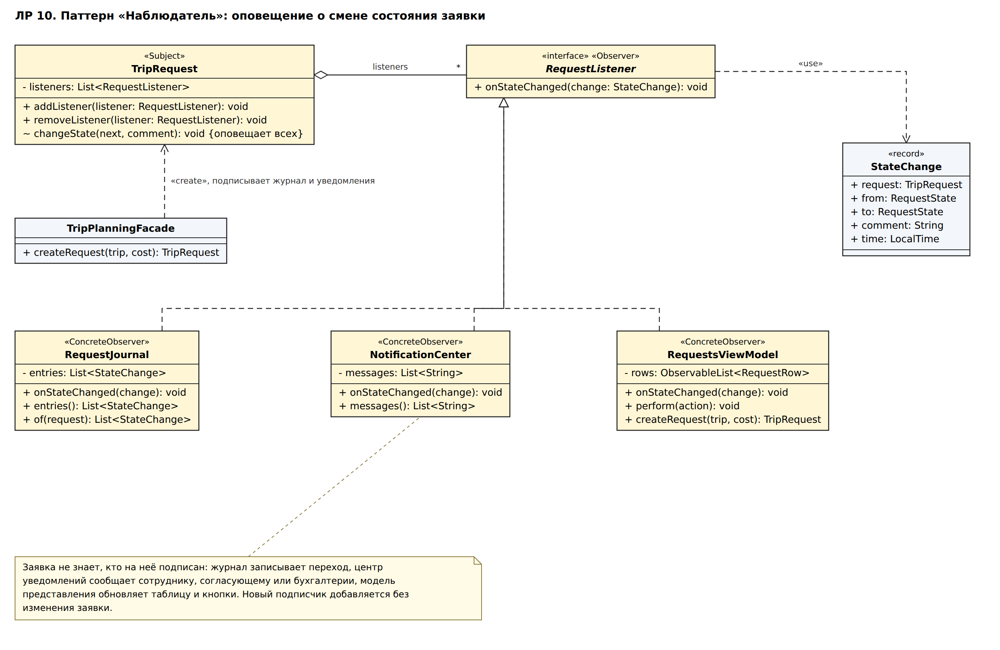

### Проверка

`TripRequestStateTest` — новая заявка в черновике; полный цикл через руководителя; автосогласование; отказ по политике и возврат в черновик; запрещённое действие не меняет состояние; все наблюдатели получают каждый переход; отписанный наблюдатель не получает событий; неудачное действие не оповещает. `TripPlannerMediatorTest` — заявка создаётся с вкладки «Расчёт», вкладка «Заявки» обновляется как наблюдатель.

Исходники диаграмм: `images/lab10/*.puml`.

---

## ЛР 11. Поведенческие паттерны: Стратегия, Шаблонный метод

### Шаблонный метод (Template Method) — `model.transport`

Для сравнения транспорта нужно время в пути. У всех видов транспорта оно складывается из одинаковых этапов, различаются только их длительности:

```java
public final TravelTime estimate(double distanceKm) {      // шаблонный метод
    add("дорога до места посадки", accessHours());         // перехватчик, по умолчанию 0
    add("ожидание и посадка", boardingHours());             // перехватчик
    add("в движении", distanceKm / speedKmh());             // абстрактный шаг
    add(stopsName(), stopsHours(moving));                   // перехватчик
    add("дорога от места прибытия", egressHours());         // перехватчик
}
```

| Роль | Класс | Что задаёт |
|---|---|---|
| AbstractClass | `TravelTimeEstimator` | `estimate()` (final) — порядок этапов; `speedKmh()` — абстрактный шаг; остальные — перехватчики с нулём по умолчанию |
| ConcreteClass | `CarTime` | 80 км/ч, 15 мин отдыха на каждые 2 ч за рулём |
| ConcreteClass | `TaxiTime` | 70 км/ч, 15 мин на подачу |
| ConcreteClass | `BusTime` | 65 км/ч, автостанции, 10 мин стоянки на каждый час |
| ConcreteClass | `TrainTime` | 75 км/ч, вокзалы и посадка |
| ConcreteClass | `PlaneTime` | 700 км/ч, но 1 ч до аэропорта, 1,5 ч регистрация, 45 мин из аэропорта |

Результат — `TravelTime` с этапами; нулевые этапы в него не попадают.

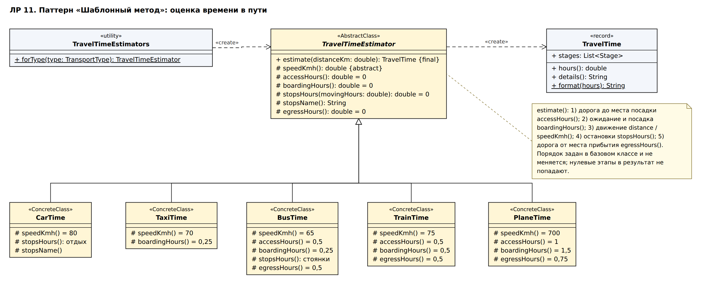

### Стратегия (Strategy) — `model.pricing`

`TransportComparison` (Context) считает все варианты одинаково, а какой из них лучший — решает подключённая стратегия `TransportChoiceStrategy`: вариант с наименьшей оценкой `score()`.

| Стратегия | Оценка |
|---|---|
| `CheapestChoice` — «Дешевле всего» | стоимость поездки |
| `FastestChoice` — «Быстрее всего» | часы в пути (с обратной дорогой) |
| `TimeValueChoice` — «Время - деньги» | стоимость + часы × цена часа × пассажиры |

Для «Командировки в Москву на поезде»: дешевле всего автобус (26 356 ₽, 57 ч 33 мин), быстрее всего самолёт (10 ч 54 мин), при 500 ₽ за час оптимален самолёт (36 440 ₽ + время = 41 890 ₽). Смена критерия в списке сразу пересортировывает сравнение.

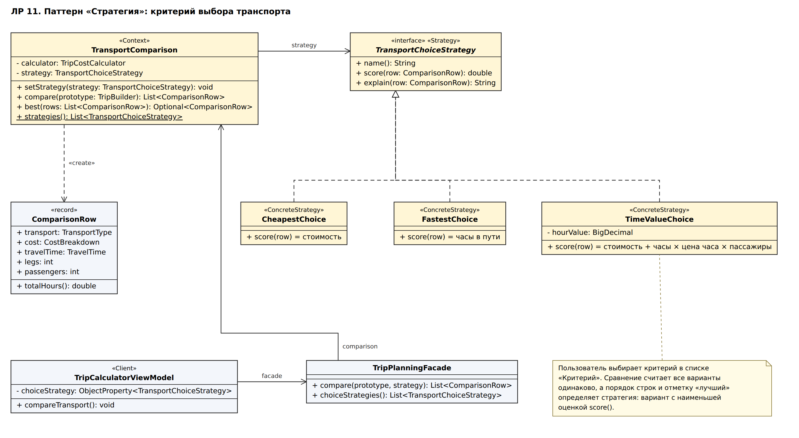

### Проверка

`TravelTimeEstimatorTest` — порядок этапов шаблонного метода, пропуск нулевых этапов, отдых водителя, самолёт проигрывает на коротком расстоянии и выигрывает на длинном, формат времени. `TransportChoiceStrategyTest` — лучший вариант по каждой стратегии, зависимость «время - деньги» от цены часа, сортировка строк и недоступные варианты в конце, удвоение времени для поездки туда и обратно.

Исходники диаграмм: `images/lab11/*.puml`.

---

## ЛР 12. Архитектурный паттерн: MVVM

Приложение с первой работы построено по схеме **MVVM**; в этой работе архитектура доведена до конца и закреплена тестом.

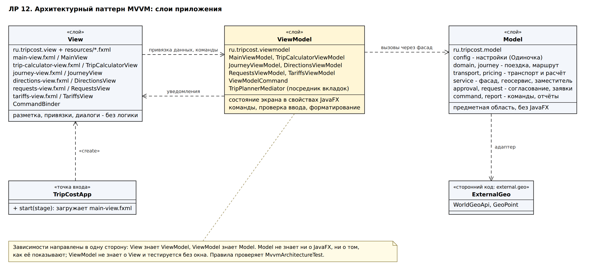

| Слой | Пакет | Что делает | Чего не знает |
|---|---|---|---|
| View | `ru.tripcost.view` + `*.fxml` | Разметка и code-behind: только привязки свойств и команд, диалоги выбора файла | Предметной логики, сервисов модели |
| ViewModel | `ru.tripcost.viewmodel` | Состояние экрана в свойствах JavaFX (`StringProperty`, `ObservableList`, …), команды, проверка ввода, форматирование, связь вкладок (посредник) | Кнопок, таблиц, окон (`javafx.scene`, `javafx.stage`) |
| Model | `ru.tripcost.model` | Предметная область: поездки, транспорт, расчёт, маршруты, заявки, фасад | JavaFX и того, как её показывают |

### Команды MVVM — `ViewModelCommand`, `CommandBinder`

Действие пользователя — объект ViewModel: что сделать (`execute()`) и можно ли сейчас (`executableProperty()`). View только связывает кнопку с командой:

```java
// JourneyViewModel
undoCommand = new ViewModelCommand(this::undo, canUndo);
removeCommand = new ViewModelCommand(this::removeSelected, hasSelection);

// JourneyView (code-behind) - ни обработчиков, ни логики доступности
CommandBinder.bind(undoButton, viewModel.undoCommand());
CommandBinder.bind(removeButton, viewModel.removeCommand());
```

На команды переведены вкладки «Маршрут» (11 команд), «Направления» и «Заявки» (команда на каждое действие с заявкой). Доступность кнопок теперь проверяется тестами без запуска окна.

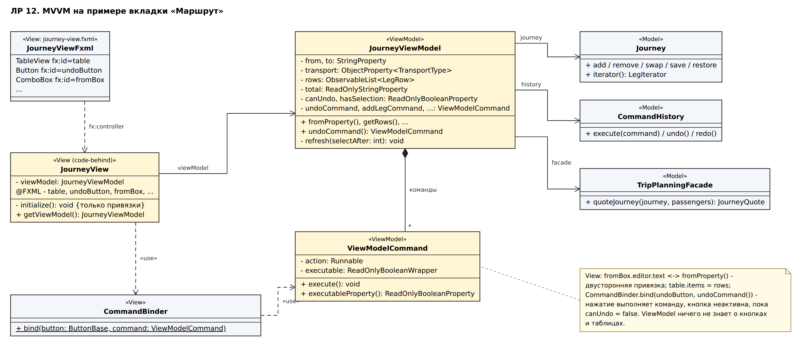

### Проверка

`MvvmArchitectureTest` — правила слоёв по исходному коду: Model не импортирует JavaFX и верхние слои; ViewModel не импортирует View и элементы интерфейса (`javafx.scene`, `javafx.fxml`, `javafx.stage`); View обращается к модели только через ViewModel (разрешены лишь типы значений для списков: `TransportType`, `TripOption`, `ReportType`, …). `ViewModelCommandTest` — команда выполняется только когда доступна; доступность команд вкладки «Маршрут» и «Направления» следует за состоянием ViewModel. Модели представления всех вкладок покрыты тестами без интерфейса (`TripPlannerMediatorTest`, `ViewModelCommandTest`).

Исходники диаграмм: `images/lab12/*.puml`.

---

## ЛР 13. Паттерны микросервисов: Сага (Saga)

### Задача

Оплата согласованной заявки — это операции в четырёх независимых сервисах: перевозчик (билеты), гостиница, страховая компания, бюджет отдела. Общей транзакции у них нет: если гостиница отказала после покупки билетов, билеты надо сдать вручную. Сага делает это автоматически.

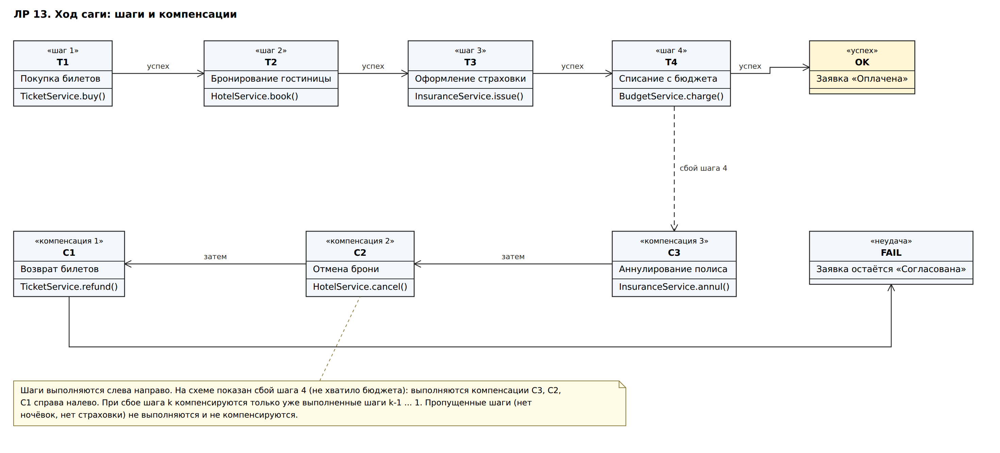

### Реализация — `model.booking` (оркестрация)

| Элемент | Класс | Что делает |
|---|---|---|
| Оркестратор | `BookingSaga` | Выполняет шаги по очереди, выполненные кладёт в стек; при отказе шага вызывает компенсации в обратном порядке |
| Шаг | `SagaStep` | `execute(order)` → номер операции, `compensate(order, номер)`, `appliesTo(order)` — нужен ли шаг |
| Шаги | `BookingSteps` | Покупка билетов ↔ возврат; бронь гостиницы ↔ отмена (только при ночёвках); полис ↔ аннулирование (только со страховкой); списание с бюджета ↔ возврат денег |
| Сервисы-участники | `TicketService`, `HotelService`, `InsuranceService`, `BudgetService` (`RemoteService`) | Своё состояние (действующие брони, остаток бюджета), имитация сбоя флагом `failing`, бюджет отказывает при нехватке денег |
| Заказ / итог | `BookingOrder`, `SagaResult`, `SagaLogEntry` | Данные для сервисов; итог с журналом ✓ выполнено, – пропущено, ✗ отказ, ↩ компенсировано |

Связь с заявкой (паттерн «Состояние»): `Approved.pay()` запускает сагу. Успех → «Оплачена» с номерами броней; неудача → заявка остаётся «Согласована», в журнале переходов причина, сотруднику уведомление «бронирование не выполнено, все шаги отменены». Сервисы и сага общие для всех заявок (фасад), поэтому бюджет расходуется от заявки к заявке: при 150 000 ₽ после командировки в Москву (28 804 ₽) и отпуска (94 118 ₽) вторая такая же поездка упрётся в бюджет — сага вернёт билеты, бронь и полис.

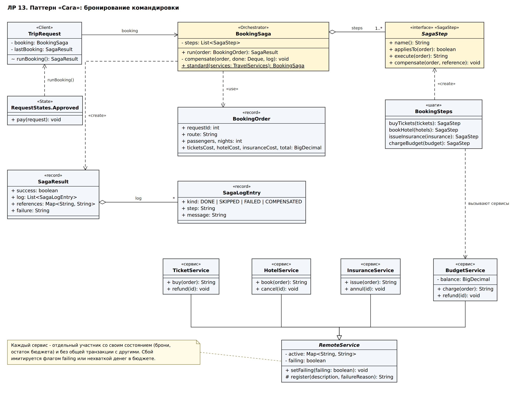

### Проверка

`BookingSagaTest` — все шаги выполнены и бюджет уменьшился; ненужные шаги пропущены; отказ гостиницы — билеты возвращены, бюджет не тронут; нехватка бюджета — компенсации страховки, гостиницы и билетов строго в обратном порядке, брони второго заказа сняты; оплата заявки: при сбое заявка остаётся согласованной с уведомлением, после устранения сбоя — «Оплачена».

Исходники диаграмм: `images/lab13/*.puml`.

---

## ЛР 14. Паттерны работы с данными: Репозиторий (Repository)

Раньше шаблоны, сохранённые пользователем, жили только до закрытия программы. Теперь они хранятся на диске, а модель работает с ними через репозиторий — как с коллекцией, не зная о файлах.

| Элемент | Класс | Что делает |
|---|---|---|
| Репозиторий | `Repository<T, ID>` | `findAll()`, `findById()`, `existsById()`, `save()` (добавить или заменить), `deleteById()`, `count()` |
| Репозиторий шаблонов | `TripTemplateRepository` | `Repository<SavedTrip, String>` — идентификатор шаблона = название |
| Сущность | `SavedTrip` | Название, поездка (`Trip`), время сохранения; `toBuilder()` — строитель для реестра прототипов |
| Реализация | `FileTripTemplateRepository` | Файл `templates.properties` (UTF-8): читает при создании, каждое изменение сразу записывает — сначала во временный файл, затем заменяет основной; повреждённые записи пропускает |
| Реализация | `InMemoryTripTemplateRepository` | Коллекция в памяти — для тестов |
| Преобразование | `SavedTripMapper` | `SavedTrip` ↔ строки `trip.N.поле=значение` |
| Клиент | `TripPlanningFacade` | При запуске загружает шаблоны из репозитория в реестр прототипов; `saveTemplate()`, `deleteTemplate()`, `isUserTemplate()` |

Пример файла:

```properties
count=1
trip.1.name=Мой отпуск
trip.1.from=Ставрополь
trip.1.to=Сочи
trip.1.transport=PLANE
trip.1.options=BAGGAGE,INSURANCE
...
```

Фасад получает репозиторий через конструктор: в программе — файловый, в тестах — в памяти или во временном файле; в `build.gradle` тесты направлены в `build/test-storage` (системное свойство `tripcost.storage.dir`), чтобы не трогать шаблоны пользователя.

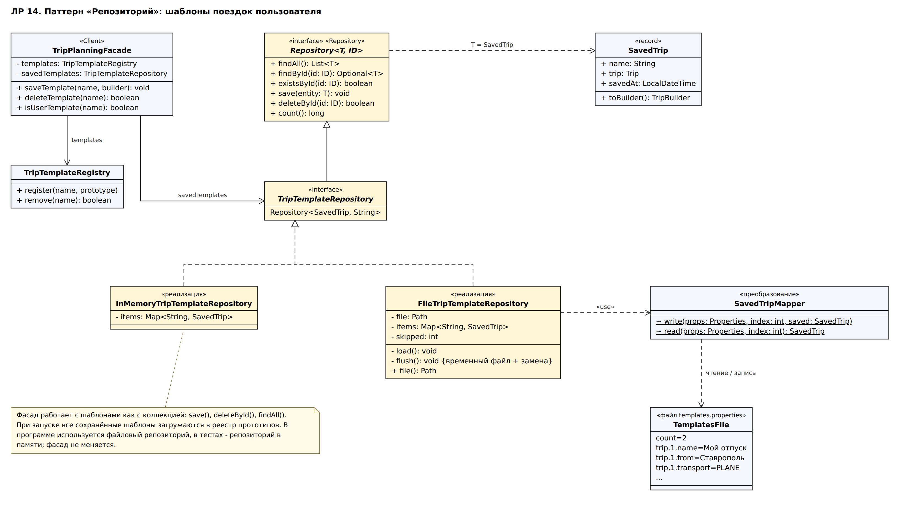

### Проверка

`TripTemplateRepositoryTest` — репозиторий в памяти ведёт себя как коллекция (замена по названию, удаление); файловый репозиторий сохраняет данные между экземплярами («перезапусками») со всеми полями поездки и услугами; удаление записывается в файл; повреждённая запись пропускается, остальные читаются; фасад восстанавливает шаблоны пользователя после перезапуска и удаляет их; встроенные шаблоны нельзя заменить или удалить.

Исходник диаграммы: `images/lab14/lab14_repository.puml`.

## ЛР 15. Идиоматические паттерны: Future / Promise (с пулом потоков)

Вкладка «Направления» считала 24 маршрута по очереди в потоке интерфейса: при первом показе (24 запроса к удалённому геосервису по 40 мс) окно замирало примерно на секунду. Теперь каждое направление — отдельная задача в пуле потоков, а метод фасада сразу возвращает обещание результата.

| Элемент | Класс | Что делает |
|---|---|---|
| Future / Promise | `AsyncJob<P, R>` | Запускает задачи через `CompletableFuture.supplyAsync()`, собирает части `allOf()` и объединяет их (`thenApply`); `result()` — обещание итога, `cancel()`, `isDone()` |
| Пул потоков | `QuotePool` | Фиксированный пул потоков-демонов `quote-N`, размер — `pool.threads` в `app.properties` (6) |
| Ход выполнения | `ProgressListener` | `progress(done, total)` после каждой готовой части |
| Поставщик обещаний | `TripPlanningFacade` | `directionsFromAsync(...)` — асинхронная версия `directionsFrom(...)` с тем же результатом |
| Потребитель | `DirectionsViewModel` | `show()` возвращает `CompletableFuture<Void>`; по `handle()` заполняет таблицу, выводит ошибку или «Расчёт отменён.»; свойства `busy`, `progress`, команда `cancelCommand` |
| Поток интерфейса | `DirectionsView` | `setUiExecutor(Platform::runLater)` — результат и ход переносятся в поток JavaFX; `ProgressBar`, кнопка «Отменить» |

Задачи выполняются одновременно, поэтому общие объекты модели сделаны потокобезопасными: кэш и счётчики заместителя расстояний (`ConcurrentHashMap`, `AtomicInteger`, ленивое создание реального сервиса с двойной проверкой), пул приспособленцев `CityFactory`, форматирование сумм (`DecimalFormat` не потокобезопасен — в отчёте он стал `ThreadLocal`, в обработчике лимита строка лимита готовится заранее).

Новый показ отменяет предыдущий, результат устаревшего расчёта отбрасывается. В тестах ViewModel работает без JavaFX: исполнитель интерфейса по умолчанию выполняет действие сразу, а тест ждёт `show().join()`.

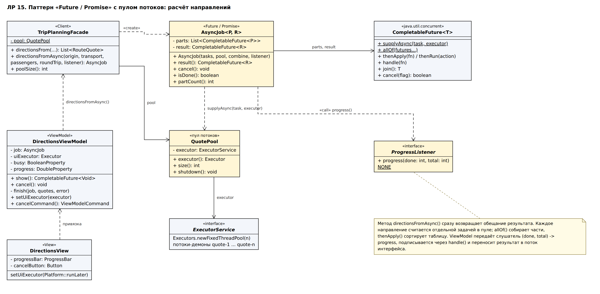

### Проверка

`AsyncDirectionsTest` — асинхронный результат совпадает с последовательным; метод возвращает незавершённое обещание, ход доходит до 24 из 24; в пуле таблица строится заметно быстрее, чем по очереди; отменённое обещание завершается `CancellationException`; ошибка одной задачи завершает обещание с ошибкой; ViewModel заполняет таблицу и снимает признак занятости. `ThreadSafetyTest` — 400 одновременных запросов к заместителю: ни один не потерян в счётчиках, реальный сервис создан один раз; приспособленец из разных потоков — один и тот же объект.

Исходник диаграммы: `images/lab15/lab15_future.puml`.
